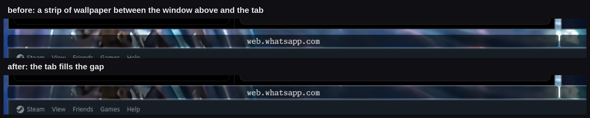

# hyprland-groupbar-gapfill

A tiny Hyprland plugin that makes a window group's tab bar (`Super+G`) fill the
layout gap above it, instead of leaving a strip of wallpaper between the tab and
the window above.



- Windows **without** a tab bar: untouched, they keep `general:gaps_in` /
  `general:gaps_out` exactly as Omarchy and friends ship them.
- A grouped window **below another window**: the tab strip moves up by the gap
  between the two tiles (`gaps_in` top + bottom), so the tab sits flush under
  the window above. The window grows by that amount at the top; nothing else
  moves.
- A grouped window at the **top edge of the workspace**: left alone, so
  `gaps_out` survives where there is no window to fill up to.
- Tab height, title centring, colours, font and padding are **not** touched.
  This is purely about the gap.

Only `gaps_in`/`gaps_out` matter. Any groupbar styling you already have keeps
working.

## Requirements

Hyprland 0.56.x (tested with 0.56.2) with headers available to `pkg-config`
(`hyprland.pc`, shipped by the Hyprland package on Arch).

Hyprland's plugin ABI is locked to the exact build, so a plugin built for one
Hyprland version will be refused by another. After every Hyprland update,
rebuild and reinstall.

## Install

### Build it yourself

```sh
git clone https://github.com/londospark/hyprland-groupbar-gapfill
cd hyprland-groupbar-gapfill
make install           # -> ~/.local/lib/hyprland/groupbar-gapfill.so
```

Then load it from your Hyprland config.

Lua config (Omarchy 3.x):

```lua
hl.plugin.load(os.getenv("HOME") .. "/.local/lib/hyprland/groupbar-gapfill.so")
```

`hyprland.conf` (absolute path; the plugin system does not expand `~`):

```
plugin = /home/you/.local/lib/hyprland/groupbar-gapfill.so
```

### With hyprpm

```sh
hyprpm add https://github.com/londospark/hyprland-groupbar-gapfill
hyprpm enable groupbar-gapfill
hyprpm reload
```

`hyprpm` builds the plugin and loads the built copy from its own store. On a Lua
config, `hyprpm enable` cannot write the load line for you; load the built
`.so` with `hl.plugin.load(...)` instead (see `hyprpm list` for its path).

### Try it without editing your config

```sh
hyprctl plugin load  ~/.local/lib/hyprland/groupbar-gapfill.so
hyprctl plugin unload ~/.local/lib/hyprland/groupbar-gapfill.so
```

## How it works

The group bar decoration reserves space at the top of its window for the tab
strip, and Hyprland's layout uses that reservation to decide where the window box
starts on the tile.

The plugin hooks `CWindow::getFullWindowReservedArea()` and shaves the reserved
top by `gaps_in` (top + bottom) for any window that is not at the top edge of its
monitor. The layout then places the window that much higher on the tile. The tab
is positioned relative to the window box, so it moves up with it and its top edge
lands on the window above.

Only the layout input changes. The decoration keeps its declared height, its box
and its input extents, so the tab stays the configured height, stays centred, and
stays clickable right across the part that reaches into the gap.

Windows are clamped to the workspace edge using the monitor's reserved area plus
`gaps_out` (top), which is why the outer gap survives at the top of a workspace.

Gaps are read at load time and re-read on every config reload; if they changed,
the layout is recalculated, so no plugin reload is needed.

## Caveats

- The plugin hooks an internal C++ method. It is version-locked by design and a
  future Hyprland refactor may need a source change, not just a rebuild.
- Only the group bar is affected; title bars and other decorations are not.

## Uninstall

Remove the load line from your config and delete
`~/.local/lib/hyprland/groupbar-gapfill.so` (or `hyprpm remove
groupbar-gapfill` if you installed it that way).

## License

MIT. See [LICENSE](LICENSE).
